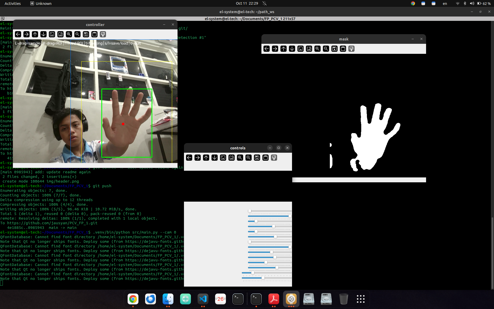
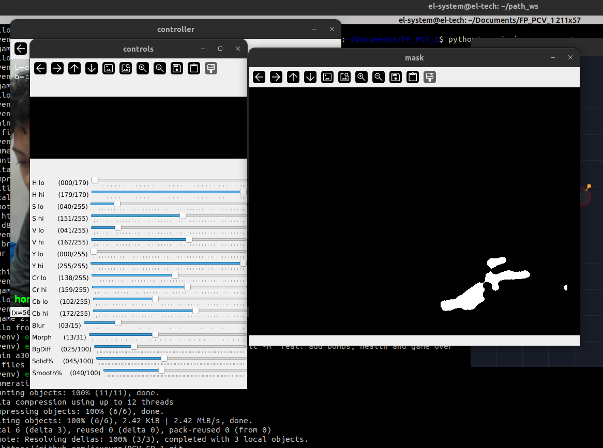
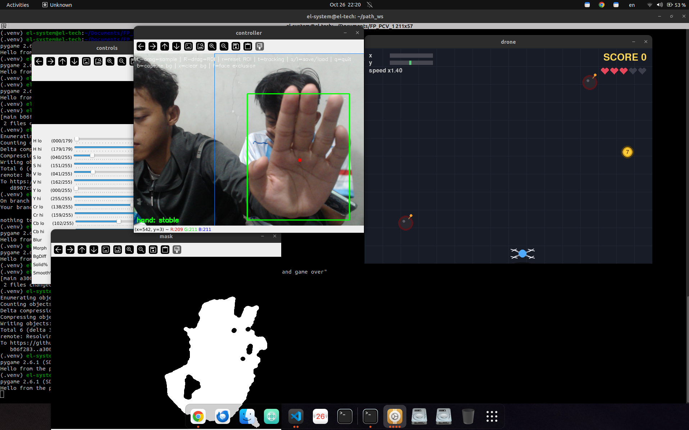

# 

# LiftOff-CV V1
by Mohammad Khirz El Jausyan - 5024241009

a simple hand vision controlled drone simulator for beginner

## Features

the Development now Oct 11, I Just added a mirrored webcam feed and uses HSV and YCrCb color thresholds to detect a hand. Gaussian blur and morphological filtering help reduce image noise. When a hand is detected, the app marks its bounding box and center point, while a separate window shows the detection mask. You can select a camera with `--cam` and quit by pressing `q`. Hand movement controls for the 2D drone simulator are planned.

## Run

Install dependencies and start :

```bash
pip install -r requirements.txt
python src/main.py
```

Use `--cam 1` to select another camera. Press `q` to quit.

## Overview

Development progress: the current prototype shows the mirrored webcam feed and visualizes hand detection with a bounding box, center point, and mask.

<p align="center">
  
</p>

## Project timeline

### 1. Hand capture and stable tracking

The first stage captures the hand from the webcam and uses a region of interest (ROI) to focus detection. This helps make detection more stable and reduces jitter in the hand's bounding box.

<p align="center">
  
</p>

### 2. Color threshold calibration

The thresholding calibration stage tunes the color range used to identify the hand in different camera conditions.

<p align="center">
  
</p>

### 3. Hand tracking controls the game

The tracked hand's pixel position changes are mapped to controls in the Pygame simulator.

<p align="center">
  
</p>

## Tech stack and approach

- **Python** for the application.
- **OpenCV** for webcam input, image processing, and display.
- **NumPy** for image and threshold operations.
- **Hand detection:** color thresholding in HSV and YCrCb, with blur and morphological filtering. ROI restriction and background rejection are planned to improve detection.
- **Game:** a 2D drone simulator controlled by hand movements; game controls and simulator are planned.
