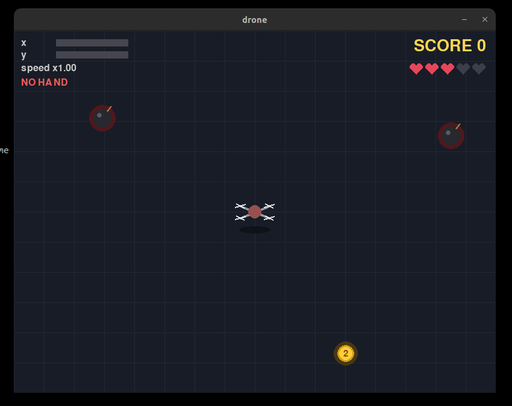
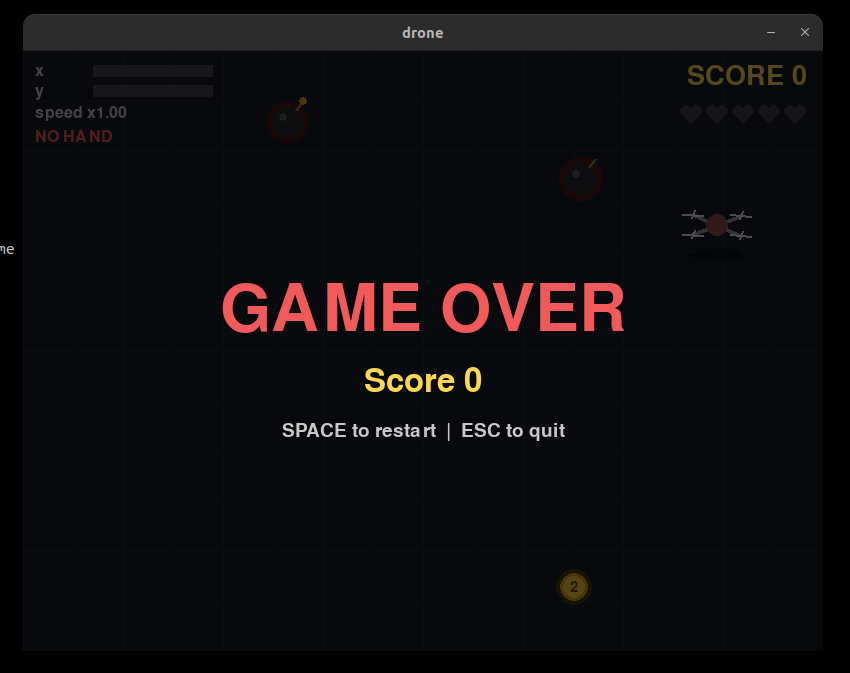

# 

# LiftOff-CV V1
by Mohammad Khirz El Jausyan - 5024241009

a simple hand vision controlled drone simulator for beginner

## Features

The app displays a mirrored webcam feed and detects a hand using HSV and YCrCb color thresholds. An adjustable region of interest (ROI) limits where the detector searches, and tracking narrows the search around the last hand position. A captured background model rejects pixels that have not changed, helping reduce false detections from the scene. The bounding box and center are smoothed to reduce jitter, and the detection mask is shown in a separate window. Hand position controls the Pygame drone simulator. Select a camera with `--cam` and press `q` to quit.

## Run

Install dependencies and start :

```bash
pip install -r requirements.txt
python src/main.py
```

Use `--cam 1` to select another camera. Press `q` to quit.

## Overview

Development progress: the current prototype shows the mirrored webcam feed and visualizes hand detection with a bounding box, center point, and mask.

<p align="center">
  
</p>
gameplay

<p align="center">
  
</p>
gameover display

## Project timeline

### 1. Hand capture and stable tracking

The first stage captures the hand from the webcam and uses a region of interest (ROI) to focus detection. This helps make detection more stable and reduces jitter in the hand's bounding box.

<p align="center">
  
</p>

### 2. Color threshold calibration

The thresholding calibration stage tunes the color range used to identify the hand in different camera conditions.

<p align="center">
  
</p>

### 3. Hand tracking controls the game

The tracked hand's pixel position changes are mapped to controls in the Pygame simulator.

<p align="center">
  
</p>

## Feature

1. **Set the ROI:** Detection runs only inside the selected area of the camera frame. You can draw an ROI to focus on the space where your hand will move.
2. **Capture the background:** Capture a model of the empty scene with your hand out of view. The app averages 30 frames, then compares each new frame with that model. Pixels whose color change exceeds the background threshold are kept, which helps reject static background objects.
3. **Find the hand:** Within the ROI and changed-pixel mask, the app applies HSV and YCrCb color thresholds. Gaussian blur and morphological opening and closing reduce noise; the largest valid contour is used as the hand candidate. Face regions can also be excluded.
4. **Stabilize and control:** Once tracking starts, the search area follows the previous bounding box. Position smoothing, stable-frame checks, jump limits, and a short hold after missed detections reduce jitter. The hand's position and apparent size are mapped to Pygame movement controls.

## Tech stack and approach

- **Python** for the application.
- **OpenCV** for webcam input, image processing, and display.
- **NumPy** for image and threshold operations.
- **Hand detection:** HSV/YCrCb color thresholding, adjustable ROI, background difference mask, optional face exclusion, and smoothed contour tracking.
- **Game:** Pygame 2D drone simulator controlled by hand position and size.
